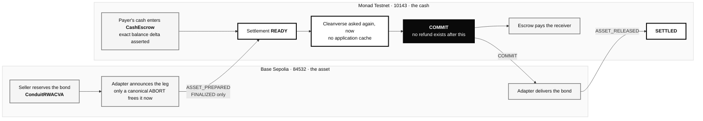
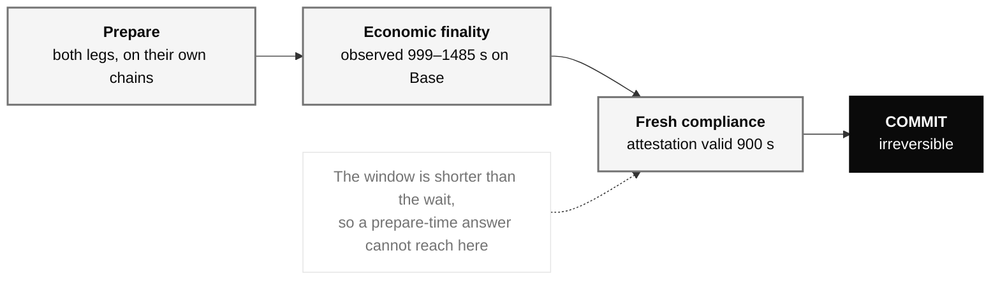
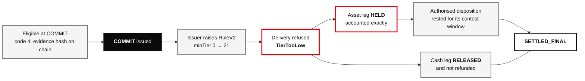
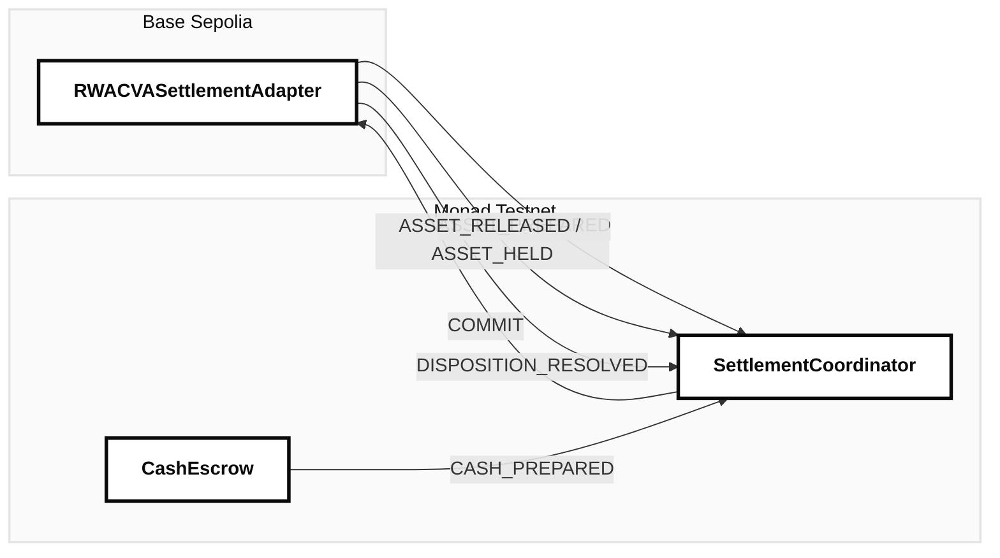

# Conduit

Cross-chain delivery-versus-payment for Cleanverse-native assets. Both assets
stay on their issuance chains; what crosses is authenticated settlement state.

**Live:** <https://conduit.timjosh507.workers.dev>

---

## Why Conduit

A restricted bond lives on one chain. The cash to pay for it lives on another.
Neither should move.

Two problems make that trade hard, and they compound:

**The chains do not finalize together.** Base Sepolia's finality has run between
999 and 1485 seconds on this deployment; Monad's is roughly a block. Whoever
moves first is exposed for the difference.

**Compliance can change while the settlement is in flight.** Eligibility is not a
property of an address, it is an answer at a moment. An issuer can raise a
minimum tier between the moment you commit and the moment you deliver — and on
this deployment, one did.

The naive answer is a bridge, which replaces a settlement problem with a custody
problem and a wrapped supply to attack. Conduit does not bridge anything.

## How it works



No token crosses a chain. Five message types cross, each verified against the
guardian set, the expected emitter, the expected deployment and the expected
message type, and each consumed exactly once.

## The irreversible boundary



COMMIT is the point of no return, and everything before it exists to make it
safe. `maxAttestationValidity` is **900 seconds**, an immutable in the deployed
bytecode that no signer can widen. Every Base finality observation on this
deployment is longer than that.

So a prepare-time compliance answer _cannot structurally reach_ a commit. The
query that authorises one happens after the wait, by construction rather than by
discipline.

## When compliance changes after COMMIT

The seller has been paid. Reversing that would be theft from one side to protect
the other, so Conduit does not unwind — it holds.



That is not a design sketch. It is settlement
[`0xc113ad33…`](https://conduit.timjosh507.workers.dev/app/settlements/0xc113ad335d202d985d527b0a193498ef2ecceb9a129a58c5002943c88601a3b0),
live on testnet, with every transaction in
[the evidence manifest](docs/evidence/MANIFEST.md).

## Cleanverse integration

| Layer      | What Conduit uses it for                                                             |
| ---------- | ------------------------------------------------------------------------------------ |
| **CVI**    | participant eligibility — `verify_apass`, and `validator/verify` where a pool exists |
| **CVA**    | both settlement assets are registered Cleanverse CVAs, ISSUED                        |
| **RuleV2** | the issuer's transfer policy, configured and independently queryable                 |

Conduit asks twice and treats the two answers as different questions: a preflight
when terms are composed, and a fresh query immediately before the irreversible
COMMIT with no application cache. Where a delivery is refused at the moment of
transfer, the leg holds.

Four distinctions the integration is built around, because collapsing any of them
produces a wrong answer:

| What arrives                   | What it is not          | What it is                                    |
| ------------------------------ | ----------------------- | --------------------------------------------- |
| `HTTP 200`                     | business success        | a transport result; the body still decides    |
| `validator/verify valid:false` | an API failure          | a decision — this participant is not eligible |
| `verify_apass code 4`          | one of four equal codes | the only code that authorises a transfer      |
| a timeout or a gateway error   | a refusal               | the absence of a decision; nobody was asked   |

## Wormhole integration

Wormhole carries settlement _facts_. There is no wrapped supply anywhere in the
system because there is nothing to wrap.



Each peer is locked to one remote emitter. Each message is checked for emitter
chain, emitter address, deployment id, protocol version and message type before
its payload is read, and its VAA hash is burned before any token moves. Finality
is **classified, never ranked**: Wormhole encodes 200 as instant and 201 as safe,
so comparing the raw byte would place instant above finalized.

A compromised relayer can delay a settlement. It cannot forge one.

## Live deployments

Generation 3, canonical. Core contracts are non-upgradeable, so a new version is
a new generation and old settlements stay verifiable against the one that
produced them.

| Chain         | Contract                        | Address           | Source                                                                     | Explorer                                                                                              | Verified source                                                                        |
| ------------- | ------------------------------- | ----------------- | -------------------------------------------------------------------------- | ----------------------------------------------------------------------------------------------------- | -------------------------------------------------------------------------------------- |
| Monad Testnet | **SettlementCoordinator**       | `0xb08bC7F2…7A61` | [`SettlementCoordinator.sol`](contracts/src/SettlementCoordinator.sol)     | [View contract](https://testnet.monadexplorer.com/address/0xb08bC7F285dd3fC1047798b661E93AB7427a7A61) | [Sourcify](https://repo.sourcify.dev/10143/0xb08bC7F285dd3fC1047798b661E93AB7427a7A61) |
| Monad Testnet | **CashEscrow**                  | `0x8151D682…8930` | [`CashEscrow.sol`](contracts/src/CashEscrow.sol)                           | [View contract](https://testnet.monadexplorer.com/address/0x8151D682836f5B7106181bc8e48DC899ab538930) | [Sourcify](https://repo.sourcify.dev/10143/0x8151D682836f5B7106181bc8e48DC899ab538930) |
| Monad Testnet | **ConduitSandboxSettlementCVA** | `0xFEfd2eA2…1F16` | [`ConduitRWACVA.sol`](contracts/src/ConduitRWACVA.sol)                     | [View contract](https://testnet.monadexplorer.com/address/0xFEfd2eA28dB25c720ec5298964F8d2F34e3f1F16) | [Sourcify](https://repo.sourcify.dev/10143/0xFEfd2eA28dB25c720ec5298964F8d2F34e3f1F16) |
| Monad Testnet | **ConduitVaultRegistrar**       | `0x3FFd3944…EBA5` | [`ConduitVaultRegistrar.sol`](contracts/src/ConduitVaultRegistrar.sol)     | [View contract](https://testnet.monadexplorer.com/address/0x3FFd39444EBba2307B34c5F36F96e4e04511EBA5) | [Sourcify](https://repo.sourcify.dev/10143/0x3FFd39444EBba2307B34c5F36F96e4e04511EBA5) |
| Monad Testnet | **AuthorityRegistry**           | `0xEa92410a…D1D7` | [`AuthorityRegistry.sol`](contracts/src/AuthorityRegistry.sol)             | [View contract](https://testnet.monadexplorer.com/address/0xEa92410aBCc1712C303174E3a2Cf4FF6Dfc7D1D7) | [Sourcify](https://repo.sourcify.dev/10143/0xEa92410aBCc1712C303174E3a2Cf4FF6Dfc7D1D7) |
| Monad Testnet | **DispositionController**       | `0x3c4060D4…fe81` | [`DispositionController.sol`](contracts/src/DispositionController.sol)     | [View contract](https://testnet.monadexplorer.com/address/0x3c4060D402675A25CAd836247CFA0B95614efe81) | [Sourcify](https://repo.sourcify.dev/10143/0x3c4060D402675A25CAd836247CFA0B95614efe81) |
| Base Sepolia  | **AuthorityRegistry**           | `0x33BB1eBa…0E45` | [`AuthorityRegistry.sol`](contracts/src/AuthorityRegistry.sol)             | [View contract](https://sepolia.basescan.org/address/0x33BB1eBa633d527f664bEFEd0FD6F13E0bE70E45)      | [Sourcify](https://repo.sourcify.dev/84532/0x33BB1eBa633d527f664bEFEd0FD6F13E0bE70E45) |
| Base Sepolia  | **DispositionController**       | `0xEa92410a…D1D7` | [`DispositionController.sol`](contracts/src/DispositionController.sol)     | [View contract](https://sepolia.basescan.org/address/0xEa92410aBCc1712C303174E3a2Cf4FF6Dfc7D1D7)      | [Sourcify](https://repo.sourcify.dev/84532/0xEa92410aBCc1712C303174E3a2Cf4FF6Dfc7D1D7) |
| Base Sepolia  | **ConduitRWACVA**               | `0xDdB1AE56…989B` | [`ConduitRWACVA.sol`](contracts/src/ConduitRWACVA.sol)                     | [View contract](https://sepolia.basescan.org/address/0xDdB1AE5685F4033Ed10B3DfCe5e9dc13D3e4989B)      | [Sourcify](https://repo.sourcify.dev/84532/0xDdB1AE5685F4033Ed10B3DfCe5e9dc13D3e4989B) |
| Base Sepolia  | **RWACVASettlementAdapter**     | `0xb08bC7F2…7A61` | [`RWACVASettlementAdapter.sol`](contracts/src/RWACVASettlementAdapter.sol) | [View contract](https://sepolia.basescan.org/address/0xb08bC7F285dd3fC1047798b661E93AB7427a7A61)      | [Sourcify](https://repo.sourcify.dev/84532/0xb08bC7F285dd3fC1047798b661E93AB7427a7A61) |

Every address above has code, runs bytecode whose hash matches its deployment
manifest, and has **full creation and runtime source matches on Sourcify**.
That is checked from the public endpoint on every `pnpm verify` run, recorded in
[`docs/evidence/onchain-verification.json`](docs/evidence/onchain-verification.json)
with a timestamp, and a Sourcify outage fails the gate rather than passing it —
"we could not ask" and "the answer was yes" are different answers.

Core contracts are **non-upgradeable**. There is no proxy, no admin key that can
change behaviour, and no implementation slot to read: a new version is a new
generation, and old settlements stay verifiable against the generation that
produced them. Superseded generations are in
[docs/deployments.md](docs/deployments.md).

Read that table twice. `0xb08bC7F2…` is the **coordinator on Monad and the
adapter on Base**; `0xEa92410a…` is the **Monad registry and the Base
controller**. Same deployer, same nonce sequence, two chains — and it has
happened four times across three generations. Identity here is
`(chainId, address)` everywhere, never an address alone, and a test fails the
build if a unique key on a bare address appears in the schema
([ADR-0018](docs/adr/0018-identity-is-a-pair-never-an-address.md)).

## Live evidence

| What                                  | Where                                                                                                                                      |
| ------------------------------------- | ------------------------------------------------------------------------------------------------------------------------------------------ |
| A participant settling from a browser | [`0xd46775dc…`](https://conduit.timjosh507.workers.dev/app/settlements/0xd46775dc9cbcdfdd4f60df1c9de4de15fc609b29f47f1d3d1860e398c33aca77) |
| Independently verified                | [SETTLED_FINAL, 18/18](https://conduit.timjosh507.workers.dev/verify/0xd46775dc9cbcdfdd4f60df1c9de4de15fc609b29f47f1d3d1860e398c33aca77)   |
| Compliance changed after COMMIT       | [`0xc113ad33…`](https://conduit.timjosh507.workers.dev/app/settlements/0xc113ad335d202d985d527b0a193498ef2ecceb9a129a58c5002943c88601a3b0) |
| Everything, in one document           | [docs/evidence/MANIFEST.md](docs/evidence/MANIFEST.md)                                                                                     |

The console is the product: a participant connects a wallet, is checked against
Cleanverse live, composes terms, signs an EIP-712 intent, sends a counterparty a
link, reserves, escrows, waits out finality, is checked again, commits, releases
both legs — and files a disposition if delivery is refused. No CLI at any point,
and no step simulated.

## Disposition Kernel

Committed value that cannot be delivered moves only through an order a
registered authority signed, which rests for a contest window before it can
execute. Two authorities who genuinely disagree produce `CONTESTED` and nothing
moves — without the wait, whichever relayer submitted first would decide.

| Type                        | Status                | Destination rule                                            |
| --------------------------- | --------------------- | ----------------------------------------------------------- |
| `REVERIFY_AND_RESUME`       | **LIVE DEMONSTRATED** | must equal the current intended receiver                    |
| `RETURN_TO_ELIGIBLE_SENDER` | IMPLEMENTED + TESTED  | must equal the original sender, and only after a COMMIT     |
| `RESTRICTED_HOLD`           | IMPLEMENTED + TESTED  | must be a registered restricted custodian                   |
| `OPERATOR_ASSISTED_OFFRAMP` | IMPLEMENTED + TESTED  | must be a registered gateway account                        |
| `REBIND_RECEIVER`           | IMPLEMENTED + TESTED  | same registered identity commitment as the current receiver |
| `AUTHORIZED_SUBSTITUTION`   | IMPLEMENTED + TESTED  | must be an approved substitute for the current receiver     |

`REVERIFY_AND_RESUME` needs the weakest authority because it has no destination
parameter at all: it can only retry the delivery the settlement already agreed
to. Every other type is an authorisation to send value somewhere the intent never
named.

## Security

Full model in [docs/threat-model](docs/threat-model/), waivers in
[docs/security-waivers](docs/security-waivers/).

**The attestation layer is not trustless, and this deployment does not claim it
is.** Every value-moving call demands a quorum of compliance attestations signed
by an address the contract's registered signer set contains. The contract proves
that an authorised signer asserted eligibility and bound it to this settlement,
this intent and a window it cannot widen. It **cannot** prove the signer asked
Cleanverse, or that Cleanverse answered that way — nothing on chain can, without
a signature from Cleanverse itself.

This deployment runs one Conduit-operated signer at a quorum of one, so
compromise of that key is compromise of the eligibility verdict. It is not
compromise of custody: the key cannot move a token, sign an intent, create a
settlement, decide one without both parties' signatures and a canonical `READY`,
or release a leg without a COMMIT already on chain. Recorded as **T-08** and
**T-09**, accepted with a
[written waiver](docs/security-waivers/attestation-signer-quorum.md).
Multiple independent attestors, a threshold quorum, TEE-backed attestors and
directly verifiable Cleanverse signatures are future architecture; none is
implemented here. `setComplianceQuorum` exists on chain today — what is missing
is a second independent operator.

Also enforced, and tested:

| Property                          | Where it is enforced                                                    |
| --------------------------------- | ----------------------------------------------------------------------- |
| No refund after COMMIT            | invariant I4, and the asset-side mirror R4                              |
| Every VAA consumed exactly once   | burned before any token moves                                           |
| Generation isolation              | a settlement is answerable only by its own generation                   |
| Finality classified, never ranked | [ADR-0013](docs/adr/0013-finality-policy-for-economic-authorization.md) |
| Identity is `(chainId, address)`  | [ADR-0018](docs/adr/0018-identity-is-a-pair-never-an-address.md)        |

## Testing

```text
Vitest      760 assertions, 32 files
Foundry     281 tests, 19 suites — 9 fuzz properties at 256 runs each,
                                   26 disposition invariants,
                                   10 exploit regressions
Playwright   76 browser tests against the deployed surface, plus 1 opt-in live run
Gate        17/17 steps: format, lint, typecheck, unit, contracts build/test/gas/
            layout, trace corpus, Slither, gitleaks, pnpm audit, Trivy, Checkov,
            manifests, end-to-end
```

The browser suite drives the whole write flow — reserve, announce, approve,
escrow, consume the finalized message, ask compliance again, commit, release both
legs, report and record — against a scripted chain that advances only by decoding
the selector the browser actually encoded. An app that skips a call never moves
the state and the assertion fails.

## Known limitations

Stated here rather than buried. A submission that hides them is worth less.

**One controlled identity.** `generate_apass` returns 403 for this credential, so
no second A-Passed wallet can exist. Payer and seller are the same key. Each leg
still moves value into and out of a settlement contract, and conservation is
proven at the escrow balance and at the reservation rather than at a wallet
delta — but this is not a demonstration of two counterparties. It is why
`REBIND_RECEIVER` and `AUTHORIZED_SUBSTITUTION` have no live destination to
reach.

**Attestation quorum of one.** See Security above.

**Not aUSDC.** The Monad cash leg settles in a sandbox CVA that we issued and
registered ourselves. It calls the live CCP policy on every transfer and holders
need real CVI, so the architecture holds — but no reserve of any kind stands
behind it. Cleanverse's aUSDC faucet reverts on its own empty source wallet and
direct deposits are refunded as non-whitelisted.

**Public testnet guardian configuration.** Wormhole's testnet guardian set is
1-of-1. A property of the network, not of this design, and not mainnet-grade
quorum.

**No CCP validator pool on the asset chain.** `validator/grant` on Base was
refused for this credential, so commit-time eligibility on the asset leg rests on
`verify_apass` plus the on-chain CCP policy rather than on both sources.

**Fiat off-ramp does not complete.** SELL quoting is live on five networks with
real quote tokens and real pricing; the hosted widget refuses with
`RM_003 Unable to verify APass on chain`, the same blocker as above. The on-chain
`OPERATOR_ASSISTED_OFFRAMP` disposition is real; no fiat settlement is claimed.

**Evidence is repository-backed, not object storage.** The evidence page names the
repository path of every package rather than claiming a content-addressed
publication, and `pnpm evidence:check` byte-compares what it serves against
`docs/evidence`. ASM-039 stays open.

**`CONTESTED` is a verifier classification, not an on-chain settlement state.**
Driving the coordinator's enum from a remote leg's contested case would need a
message PRD 7.3 does not define, and ADR-0015 forbids inventing one.

**Testnet only.** No mainnet deployment and no mainnet claim.

## Run locally

```bash
pnpm install
pnpm verify                      # the full 17-step gate
pnpm conduit doctor              # environment, both chains, every Cleanverse capability
pnpm conduit verify <settlementId>
pnpm evidence:check              # what the site serves still matches docs/evidence
```

Contracts are Foundry, exact-pinned to solc 0.8.36. Everything else is TypeScript
strict.

## Documentation

| Where                                                                  | What                                           |
| ---------------------------------------------------------------------- | ---------------------------------------------- |
| [docs/submission.md](docs/submission.md)                               | the submission package, and the rubric mapping |
| [docs/evidence/MANIFEST.md](docs/evidence/MANIFEST.md)                 | every transaction, message and check           |
| [docs/implementation-status.md](docs/implementation-status.md)         | what is LIVE, tested, blocked or future        |
| [docs/adr/](docs/adr/)                                                 | 21 decisions, including the ones we got wrong  |
| [docs/threat-model/](docs/threat-model/)                               | 48 threats bound to 13 invariants              |
| [docs/evidence/observed-latency.md](docs/evidence/observed-latency.md) | 12 finality samples, never averaged            |
